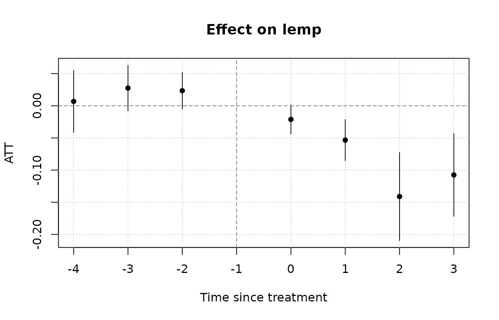
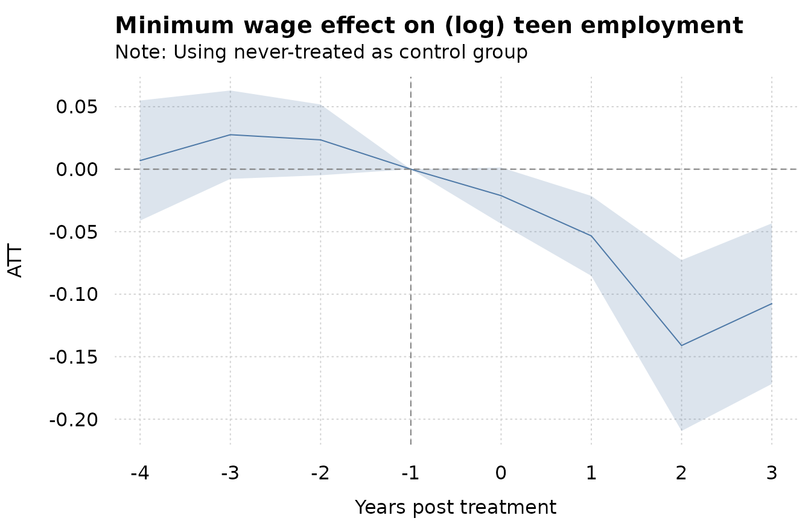
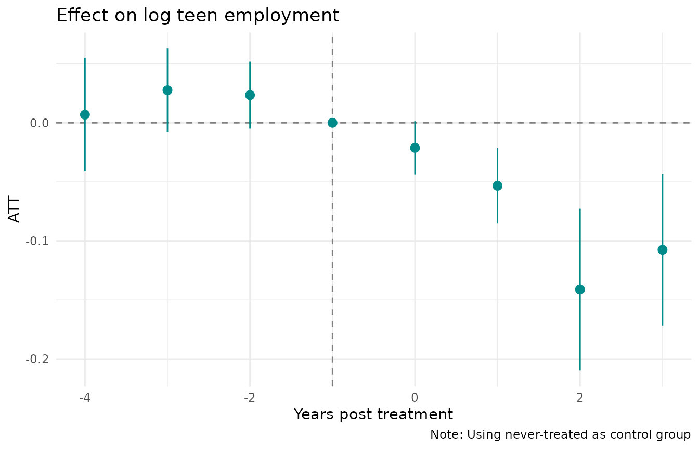
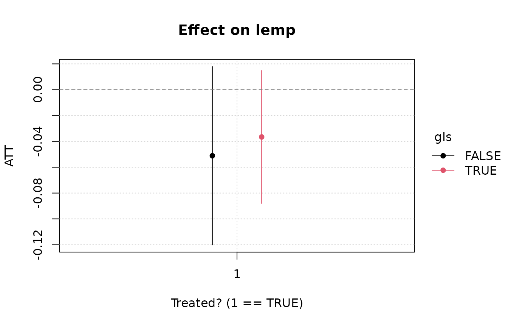
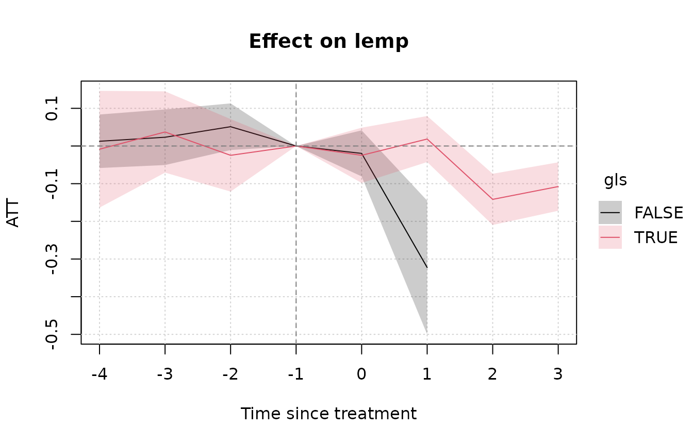
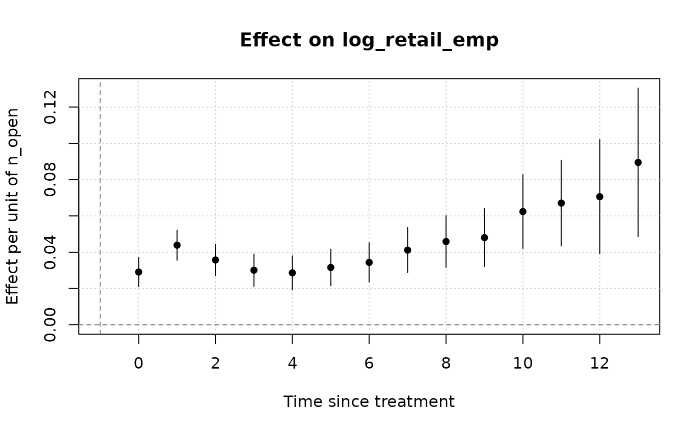
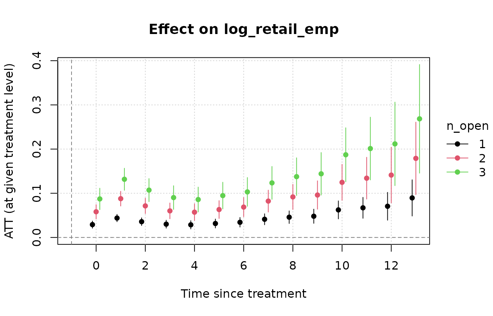
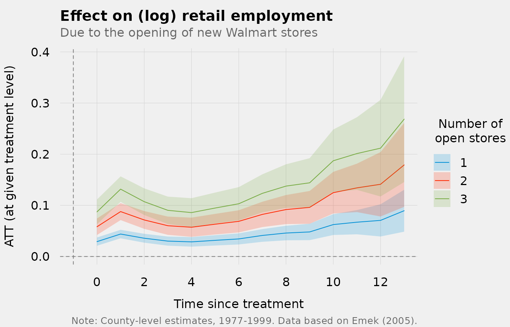
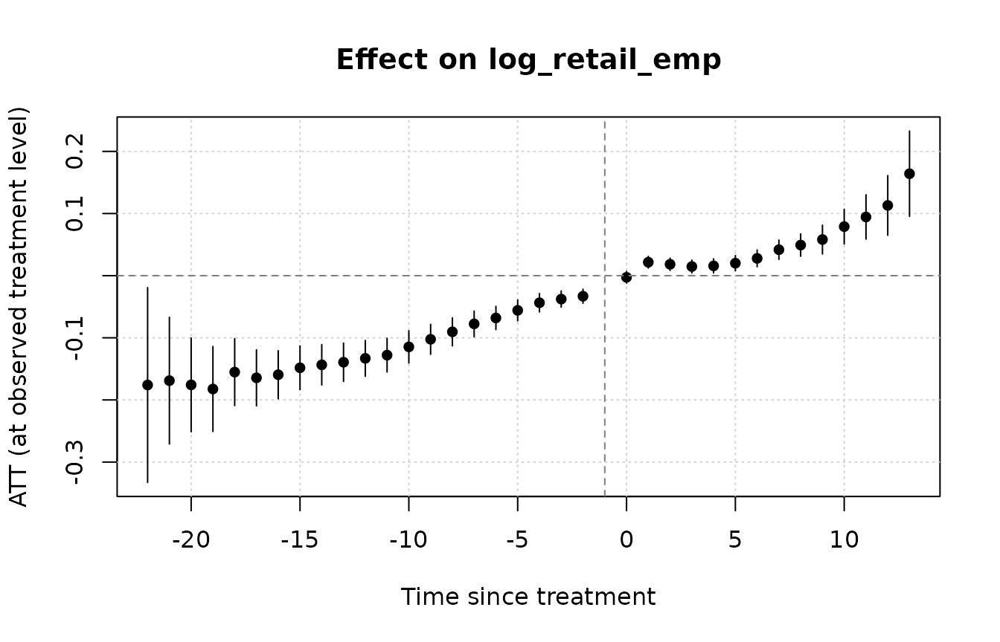

# Introduction to etwfe

## Background

A canonical research design for social scientists is the so-called
“difference-in-differences” (DiD) design. The essential idea behind DiD
is that we can estimate the causal impact of an intervention
(“treatment”) by comparing the pre- and post-intervention outcomes of
indivduals that received treatment (“treated” group) against the
outcomes of comparable indivduals that didn’t receive treatment
(“control” group).[^1]

In the classic 2x2 DiD case (two units, two periods), a simple
interaction effect between two dummy variables suffices to recover the
treatment effect. In base R this might look something like:

``` r

lm(y ~ Dtreated_unit * Dpost_treatment, data = somedata)
```

where the resulting coefficient on the
`Dtreated_unitTRUE:Dpost_treatmentTRUE` interaction term represents the
treatment effect.

Rather than manually specify the interaction term, in practice
researchers often use an equivalent formulation known as *two-way fixed
effects* (TWFE). The core idea of TWFE is that we can subsume the
interaction term from the previous code chunk by adding unit and time
fixed effects. A single treatment dummy can then be used to capture the
effect of treatment directly. A TWFE regression in base R might look as
follows:

``` r

lm(y ~ Dtreat + factor(id) + factor(period), data = somedata)
```

where the treatment effect is now captured by the coefficient on the
`Dtreat` dummy.

The TWFE shortcut is especially nice for more complicated panel data
settings with multiple units and multiple times periods. Speaking of
which, if you prefer to use a dedicated fixed effects / panel data
package like **fixest**, you could also estimate the previous regression
like so:

``` r

library(fixest)
feols(y ~ Dtreat | id + period, data = somedata)
```

These TWFE regressions are easy to run and intuitive, and for a long
time everyone was happy. But it was too good to last. A cottage industry
of clever research now demonstrates that things are not quite so simple.
Among other things, the standard TWFE formulation can impose strange
(negative) weighting conditions on key parts of the estimation
procedure. One implication is that you risk a high probability of
estimate bias in the presence of staggered treatment rollouts, which are
very common in real-life applications.

Fortunately, just as econometricians were taking away one of our
favourite tools, they were kind enough to replace it with some new ones.
Among these, the proposed approach by Wooldridge
([2023](https://doi.org/10.1093/ectj/utad016),
[2025](https://doi.org/10.1007/s00181-025-02807-z)) is noteworthy. His
idea might be paraphrased as stating that the problem with TWFE is not
that we were doing it in the first place. Rather, it’s that we weren’t
doing it enough. Instead of only including a single treatment × time
interaction, Wooldridge recommends that we saturate our model with all
possible interactions between treatment and time variables, including
treatment cohorts, as well as other covariates. He goes on to show that
this approach actually draws an equivalence between different types of
estimators (pooled OLS, twoway Mundlak regression, etc.) So it’s not
entirely clear what to call it. But Wooldridge refers to the general
idea as as *extended* TWFE—or, ETWFE—which I rather like and is where
this package takes its name.

The Wooldridge ETWFE solution is intuitive and elegant. But it is also
rather tedious and error prone to code up manually. You have to
correctly specify all the possible interactions, demean control
variables within groups, and then recover the treatment effects of
interest via an appropriate marginal effect aggregation. The **etwfe**
package aims to simplify the process by providing convenience functions
that do all this work for you. It also supports the extension to
non-binary treatments (e.g., continuous doses or counts) proposed by
Wooldridge ([2026](https://doi.org/10.2139/ssrn.7530698)); see
[Non-binary treatments](#non-binary-treatments) below.

## Dataset

To demonstrate the core functionality of **etwfe**, we’ll use the
[`mpdta`](https://bcallaway11.github.io/did/reference/mpdta.html)
dataset on US teen employment from the **did** package (which you’ll
need to install separately).

``` r

# install.packages("did")
data("mpdta", package = "did")
head(mpdta)
#>     year countyreal     lpop     lemp first.treat treat
#> 866 2003       8001 5.896761 8.461469        2007     1
#> 841 2004       8001 5.896761 8.336870        2007     1
#> 842 2005       8001 5.896761 8.340217        2007     1
#> 819 2006       8001 5.896761 8.378161        2007     1
#> 827 2007       8001 5.896761 8.487352        2007     1
#> 937 2003       8019 2.232377 4.997212        2007     1
```

“Treatment” in this dataset refers to an increase in the minimum wage
rate. In the examples that follow, our goal is to estimate the effect of
this minimum wage treatment (`treat`) on the log of teen employment
(`lemp`). Notice that the panel ID is at the county level
(`countyreal`), but treatment was staggered across cohorts
(`first.treat`) so that a group of counties were treated at the same
time. In addition to these staggered treatment effects, we also observe
log population (`lpop`) as a potential control variable.

## Basic usage

Let’s load **etwfe** and work through its basic functionality. As we
shall see, the core workflow of the package involves two consecutive
function calls:

1.  [`etwfe()`](https://grantmcdermott.com/etwfe/reference/etwfe.md)
2.  [`emfx()`](https://grantmcdermott.com/etwfe/reference/emfx.md)

### `etwfe`

Given the package name, it won’t surprise you to learn that the key
estimating function is
[`etwfe()`](https://grantmcdermott.com/etwfe/reference/etwfe.md). Here’s
how it would look for our example dataset.

``` r

library(etwfe)

mod = etwfe(
  fml  = lemp ~ lpop, # outcome ~ controls
  tvar = year,        # time variable
  gvar = first.treat, # group variable
  data = mpdta,       # dataset
  vcov = ~countyreal  # vcov adjustment (here: clustered)
)
```

There are a few things to say about our
[`etwfe()`](https://grantmcdermott.com/etwfe/reference/etwfe.md)
argument choices and other function options, but we’ll leave those
details aside until a bit later. Right now, just know that all of the
above arguments are required except `vcov` (though I generally recommend
it too, since we probably want to cluster our standard errors at the
individual unit level).

Let’s take a look at our model object.

``` r

mod
#> OLS estimation, Dep. Var.: lemp
#> Observations: 2,500
#> Fixed-effects: first.treat: 4,  year: 5
#> Varying slopes: lpop (first.treat): 4,  lpop (year): 5
#> Standard-errors: Clustered (countyreal) 
#>                                               Estimate Std. Error   t value   Pr(>|t|)    
#> .Dtreat:first.treat::2004:year::2004         -0.021248   0.021728 -0.977890 3.2860e-01    
#> .Dtreat:first.treat::2004:year::2005         -0.081850   0.027375 -2.989963 2.9279e-03 ** 
#> .Dtreat:first.treat::2004:year::2006         -0.137870   0.030795 -4.477097 9.3851e-06 ***
#> .Dtreat:first.treat::2004:year::2007         -0.109539   0.032322 -3.389024 7.5694e-04 ***
#> .Dtreat:first.treat::2006:year::2006          0.002537   0.018883  0.134344 8.9318e-01    
#> .Dtreat:first.treat::2006:year::2007         -0.045093   0.021987 -2.050907 4.0798e-02 *  
#> .Dtreat:first.treat::2007:year::2007         -0.045955   0.017975 -2.556568 1.0866e-02 *  
#> .Dtreat:first.treat::2004:year::2004:lpop_dm  0.004628   0.017584  0.263184 7.9252e-01    
#> .Dtreat:first.treat::2004:year::2005:lpop_dm  0.025113   0.017904  1.402661 1.6134e-01    
#> .Dtreat:first.treat::2004:year::2006:lpop_dm  0.050735   0.021070  2.407884 1.6407e-02 *  
#> .Dtreat:first.treat::2004:year::2007:lpop_dm  0.011250   0.026617  0.422648 6.7273e-01    
#> .Dtreat:first.treat::2006:year::2006:lpop_dm  0.038935   0.016472  2.363731 1.8474e-02 *  
#> .Dtreat:first.treat::2006:year::2007:lpop_dm  0.038060   0.022477  1.693276 9.1027e-02 .  
#> .Dtreat:first.treat::2007:year::2007:lpop_dm -0.019835   0.016198 -1.224528 2.2133e-01    
#> ... 10 variables were removed because of collinearity
#> (.Dtreat:first.treat::2006:year::2004, .Dtreat:first.treat::2006:year::2005 and 8 others
#> [full set in $collin.var])
#> ---
#> Signif. codes:  0 '***' 0.001 '**' 0.01 '*' 0.05 '.' 0.1 ' ' 1
#> RMSE: 0.537131     Adj. R2: 0.87167 
#>                  Within R2: 8.449e-4
```

What [`etwfe()`](https://grantmcdermott.com/etwfe/reference/etwfe.md)
has done underneath the hood is construct a treatment dummy variable
`.Dtreat` and saturated it together with the other variables of interest
as a set of multiway interaction terms.[^2]

You may have noticed that our
[`etwfe()`](https://grantmcdermott.com/etwfe/reference/etwfe.md) call
returns a standard [**fixest**](https://lrberge.github.io/fixest/)
object, since this is what it uses to perform the underlying estimation.
All of the associated methods and functions from the **fixest** package
are thus compatible with our model object. For example, we could plot
the raw regression coefficients with
[`fixest::coefplot()`](https://lrberge.github.io/fixest/reference/coefplot.html),
or print them to a nice regression table with
[`fixest::etable()`](https://lrberge.github.io/fixest/reference/etable.html).
However, the raw coefficients from an
[`etwfe()`](https://grantmcdermott.com/etwfe/reference/etwfe.md)
estimation are not particularly meaningful in of themselves. Recall that
these are complex, multiway interaction terms that are probably hard to
to interpret on their own. This insight leads us to our next key
function…

### `emfx`

If the raw `etwfe` coefficients aren’t particularly useful by
themselves, what can we do with them instead? Well, we probably want to
aggregate them along some dimension of interest (e.g., by groups or
time, or as an event study). A natural way to perform these aggregations
is by recovering the appropriate marginal effects. The **etwfe** package
provides another convenience function for doing so:
[`emfx()`](https://grantmcdermott.com/etwfe/reference/emfx.md), which is
a thin(ish) wrapper around
[`marginaleffects::slopes()`](https://marginaleffects.com/man/r/slopes.html).

For example, we can recover the average treatment effect on the treated
(ATT) as follows.

``` r

emfx(mod)
#> 
#>  .Dtreat Estimate Std. Error     z Pr(>|z|)    S   2.5 %  97.5 %
#>     TRUE  -0.0506      0.013 -3.89   <0.001 13.3 -0.0761 -0.0251
#> 
#> Term: .Dtreat
#> Type: response
#> Comparison: TRUE - FALSE
```

In other words, our model is telling us that an increase in the minimum
wage leads to an approximate 5 percent decrease in teen employment.

Beyond simple ATTs,
[`emfx()`](https://grantmcdermott.com/etwfe/reference/emfx.md) also
supports other types of aggregations via the `type` argument. For
example, we can use `type = "calendar"` to get ATTs by period, or
`type = "group"` to get ATTs by cohort groups. But the option that will
probably be useful to most people is `type = "event"`, which will
recover dynamic treatment effects *a la* an event study. Let’s try this
out and then save the resulting object, since I plan to reuse it in a
moment.

``` r

mod_es = emfx(mod, type = "event")
mod_es
#> 
#>  event Estimate Std. Error     z Pr(>|z|)    S   2.5 %  97.5 %
#>      0  -0.0332     0.0135 -2.46   0.0141  6.2 -0.0597 -0.0067
#>      1  -0.0573     0.0180 -3.19   0.0014  9.5 -0.0925 -0.0222
#>      2  -0.1379     0.0339 -4.07   <0.001 14.4 -0.2042 -0.0715
#>      3  -0.1095     0.0323 -3.39   <0.001 10.5 -0.1728 -0.0463
#> 
#> Term: .Dtreat
#> Type: response
#> Comparison: TRUE - FALSE
```

Our event study suggests that the teen disemployment effect of a minimum
wage hike is fairly modest at first (3%), but increases over the next
few years (\>10%).

If you prefer a visual depiction, we also support a native `plot.emfx`
method for convenient graphical display.

``` r

plot(mod_es)
```


Note that our event study only reports post-treatment effects here.
That’s because all pre-treatment effects have been swept out of the
estimation as a result of the ETWFE setup. Specifically, under the
default setting where the control group comprises the `"notyet"` treated
units, all pre-treatment effects are mechanistically set to zero.
However, that doesn’t mean that we can’t glean anything about the state
of these pre-trends…

### Pre-trends

#### Cohort trends

Wooldridge recommends a simple statistical test for evaluating
pre-trends; namely, including a linear time trend for each cohort.
Again, **etwfe** offers a convenience method for implementing this on
your behalf via the `etwfe(..., trend = TRUE)` argument. Since these
cohort trends enter the model as regular coefficients, we can then test
their joint significance directly with
[`fixest::wald()`](https://lrberge.github.io/fixest/reference/wald.html).

It is important to note that identifying a cohort trend requires at
least two pre-treatment periods for each cohort; otherwise we can’t
construct a linear trend. Unfortunately, that rules out our minimum wage
example here, since the 2004 cohort is only observed for a single
pre-treatment year (2003). Nevertheless, we’ll see cohort trends in
action in the [non-binary treatments](#non-binary-treatments) section
below. Plus, we can always switch to a visual inspection as an
alternative, which segues nicely to our next section.

#### Visual inspection

*Subtitle: Switch to the `"never"` control group*

A natural alternative to specifying `"notyet"` treated units as a
control group is to use the never-treated units (`cgroup = "never"`)
instead. This trades off some precision (since we aren’t using all of
the available information), but it *does* have the virtue of returning
pre-treatment effects as part of the estimation. In turn, this allows us
to visually inspect for parallel pre-trends.

``` r

mod_es2 = etwfe(
  lemp ~ lpop, tvar = year, gvar = first.treat,
  data = mpdta, vcov = ~countyreal,
  cgroup = "never" # <= use never treated as control group
  ) |>
  emfx(type = "event")

plot(mod_es2)
```



Reassuringly, the pre-treatment estimates are small and statistically
insignificant, so there is no obvious violation of parallel trends here.

### Presentation

#### Plots

We’ve already seen several plotting examples, so I’ll only use this
opportunity to make two quick asides about plotting `emfx` objects.
First, you can customize your plots by overriding default arguments. We
use [**tinyplot**](https://grantmcdermott.com/tinyplot/) as a backend
and you should be able to pass through any valid argument that
`tinyplot()` understands. For example:

``` r

plot(
  mod_es2,
  type  = "ribbon",
  theme = "clean2",
  xlab  = "Years post treatment",
  main  = "Minimum wage effect on (log) teen employment",
  sub   = "Note: Using never-treated as control group",
  # file  = "event-study.png", width = 8, height = 5. ## uncomment to save file
)
```



Second, since `emfx` objects are essentially just data.frames with
additional attributes, you can easily use another plot engine if you’d
prefer. For example, assuming that you have **ggplot2** installed:

``` r

# install.packages("ggplot2")
library(ggplot2)

ggplot(mod_es2, aes(x = event, y = estimate, ymin = conf.low, ymax = conf.high)) +
  geom_hline(yintercept = 0, lty = 2, col = "grey50") +
  geom_vline(xintercept = -1, lty = 2, col = "grey50") +
  geom_pointrange(col = "darkcyan") +
  labs(
    x = "Years post treatment",
    y = "ATT",
    title = "Effect on log teen employment",
    caption = "Note: Using never-treated as control group"
  ) +
  theme_minimal()
```



#### Tables

We recommend the excellent
[**modelsummary**](https://modelsummary.com/index.html) package for
transforming your results into a nice regression table. (You will need
to install it first.) Note the use of the `shape` and `coef_rename`
arguments below; these are optional, but help to make the event-study
output look a bit cleaner.

``` r

# install.packages("modelsummary")
library(modelsummary)

# Quick renaming function to replace ".Dtreat" with something more meaningful
rename_fn = function(old_names) {
  new_names = gsub(".Dtreat", "Years post treatment =", old_names)
  setNames(new_names, old_names)
}

modelsummary(
  list(mod_es2, mod_es),
  shape       = term:event:statistic ~ model,
  coef_rename = rename_fn,
  gof_omit    = "Adj|Within|IC|RMSE",
  stars       = TRUE,
  title       = "Event study",
  notes       = "Std. errors are clustered at the county level"
)
```

|  | \(1\) | \(2\) |
|----|----|----|
| Years post treatment = -4 | 0.007 |  |
|  | (0.025) |  |
| Years post treatment = -3 | 0.028 |  |
|  | (0.018) |  |
| Years post treatment = -2 | 0.023 |  |
|  | (0.014) |  |
| Years post treatment = -1 | 0.000 |  |
| Years post treatment = 0 | -0.021+ | -0.033\* |
|  | (0.011) | (0.014) |
| Years post treatment = 1 | -0.053\*\* | -0.057\*\* |
|  | (0.016) | (0.018) |
| Years post treatment = 2 | -0.141\*\*\* | -0.138\*\*\* |
|  | (0.035) | (0.034) |
| Years post treatment = 3 | -0.108\*\* | -0.110\*\*\* |
|  | (0.033) | (0.032) |
| Num.Obs. | 2500 | 2500 |
| R2 | 0.873 | 0.873 |
| Std.Errors | Unconditional (clustered by countyreal) | Unconditional (clustered by countyreal) |
| FE..first.treat | X | X |
| FE..year | X | X |
| \+ p \< 0.1, \* p \< 0.05, \*\* p \< 0.01, \*\*\* p \< 0.001 |  |  |
| Std. errors are clustered at the county level |  |  |

Event study {#tinytable_cz2bf2bemqz1pteigpv8 .table .tinytable
style="width: auto; margin-left: auto; margin-right: auto;"
quarto-disable-processing="true"}

## Heterogeneity

So far we’ve limited ourselves to homogeneous treatment effects, where
the impact of treatment (i.e., minimum wage hike) is averaged across all
US counties in our dataset. However, many research problems require us
to estimate treatment effects separately across groups and then,
potentially, test for differences between them. For example, we might
want to test whether the efficacy of a new vaccine differs across age
groups, or whether a marketing campaign was equally successful across
genders. The ETWFE framework naturally lends itself to these kinds of
heterogeneous treatment effects.

Consider the following example, where we first create a logical dummy
variable for all US counties in the eight [Great Lake states
(GLS)](https://en.wikipedia.org/wiki/Great_Lakes_region).

``` r

gls_fips = c("IL" = 17, "IN" = 18, "MI" = 26, "MN" = 27,
             "NY" = 36, "OH" = 39, "PA" = 42, "WI" = 55)

mpdta$gls = substr(mpdta$countyreal, 1, 2) %in% gls_fips
```

Now imagine that we are interested in estimating separate treatment
effects for GLS versus non-GLS counties. We do this simply by invoking
the optional `xvar` argument as part of our
[`etwfe()`](https://grantmcdermott.com/etwfe/reference/etwfe.md)
call.[^3] Any subsequent
[`emfx()`](https://grantmcdermott.com/etwfe/reference/emfx.md) call on
this object will automatically recognize that we want to recover
treatment effects by these two distinct groups.

``` r

hmod = etwfe(
  lemp ~ lpop, tvar = year, gvar = first.treat,
  xvar = gls,           ## <= het. TEs by gls
  data = mpdta,
  cgroup = "never",
  vcov = ~countyreal
)

# Simple heterogeneous ATTs (could also specify `type = "event"`, etc.) 
(hmod_mfx = emfx(hmod))
#> 
#>  .Dtreat   gls Estimate Std. Error     z Pr(>|z|)   S  2.5 % 97.5 %
#>     TRUE FALSE  -0.0511     0.0352 -1.45    0.147 2.8 -0.120 0.0179
#>     TRUE  TRUE  -0.0366     0.0262 -1.39    0.163 2.6 -0.088 0.0149
#> 
#> Term: .Dtreat
#> Type: response
#> Comparison: TRUE - FALSE
```

The above point estimates might tempt us to think that minimum wage
hikes caused less teen disemployment in GLS counties than in the rest of
the US on average. However, to test this formally we can invoke the
powerful
[`hypotheses`](https://marginaleffects.com/man/r/hypotheses.html)
infrastructure of the underlying **marginaleffects** package. Probably
the easiest way to do this is by using `b[i]`-style positional
arguments, where “`[i]`” denotes the row of the
[`emfx()`](https://grantmcdermott.com/etwfe/reference/emfx.md) return
object. Thus, by specifying `hypothesis = "b1 = b2"`, we can test
whether the ATTs from row 1 (non-GLS) and row 2 (GLS) are different from
one another.

``` r

emfx(hmod, hypothesis = "b1 = b2")
#> 
#>  Hypothesis Estimate Std. Error      z Pr(>|z|)   S  2.5 % 97.5 %
#>       b1=b2  -0.0145     0.0565 -0.258    0.797 0.3 -0.125 0.0961
#> 
#> Type: response
```

Here we see that there is actually no statistical difference in the
average disemployment effect between GLS and non-GLS counties. We can
also confirm this with a quick visual inspection (note that we get an
automatic legend, as well as dodged pointrange bars).

``` r

plot(hmod_mfx)
```



Interesting enough, however, the full event study reveals a more complex
picture. Would the non-GLS counties have recorded a larger employment
drop-off had we been able to collect more post-treatment data? We’ll let
the the reader decide…

``` r

hmod |>
  emfx("event") |>
  plot(type = "ribbon")
```



One final aside is that you can easily display the results of
heterogeneous treatment effects in table form too. Here’s a quick
example, where we again make use of the `modelsummary(..., shape = ...)`
argument.

``` r

modelsummary(
  models      = list("GLS county" = hmod_mfx),
  shape       = term + statistic ~ model + gls, # add xvar variable (here: gls)
  coef_map    = c(".Dtreat" = "ATT"),
  gof_map     = NA,
  title       = "Comparing the ATT on GLS and non-GLS counties"
)
```

|     | GLS county |         |
|-----|------------|---------|
|     | FALSE      | TRUE    |
| ATT | -0.051     | -0.037  |
|     | (0.035)    | (0.026) |

Comparing the ATT on GLS and non-GLS counties
{#tinytable_if6fh1kkj4v1ulkhu37m .table .tinytable
style="width: auto; margin-left: auto; margin-right: auto;"
quarto-disable-processing="true"}

While the simple example here has been limited to a binary comparison of
group  
ATTs, note the same logic carries over to richer settings. We can use
the exact same workflow to estimate heterogeneous treatment effects by
different aggregations (e.g., event studies) and across groups with many
levels.

## Other families

Another key feature of the ETWFE approach—one that sets it apart from
other advanced DiD implementations and extensions—is that it supports
nonlinear model (distribution / link) families. Users need simply invoke
the `family` argument. Here’s a brief example, where we recast our
earlier event-study as a Poisson regression.

``` r

mpdta$emp = exp(mpdta$lemp)

etwfe(
  emp ~ lpop, tvar = year, gvar = first.treat, data = mpdta, vcov = ~countyreal,
  family = "poisson"
  ) |>
  emfx("event")
#> 
#>  event Estimate Std. Error       z Pr(>|z|)   S  2.5 % 97.5 %
#>      0   -25.35       22.9 -1.1047  0.26927 1.9  -70.3   19.6
#>      1     1.09       52.5  0.0208  0.98342 0.0 -101.9  104.0
#>      2   -75.12       26.1 -2.8758  0.00403 8.0 -126.3  -23.9
#>      3  -101.82       39.8 -2.5611  0.01043 6.6 -179.7  -23.9
#> 
#> Term: .Dtreat
#> Type: response
#> Comparison: TRUE - FALSE
```

## Non-binary treatments

All of the examples thus far have involved a *binary* treatment: a
county either received the minimum wage hike or it didn’t. But many
interventions come in different intensities, or “doses”. For example,
consider the size of a tax credit, the number of hours of job training,
or the number of new stores opening in a town. Not only are these
treatments non-binary, but the doses themselves might be changing over
time, e.g. more stores opening each year in a town. The good news is
that the ETWFE framework extends very naturally to these non-binary
settings. Wooldridge ([2026](https://doi.org/10.2139/ssrn.7530698))
shows that we need simply interact the treatment level (dose) with the
full set of cohort × period dummies, so that each cohort-period cell
gets its own heterogeneous slope. These slopes can then be aggregated in
all the usual ways. (Support for non-binary treatments was added in
**etwfe** v0.7.0.)

To demonstrate, we’ll use the `walmart` dataset that ships with
**etwfe**, which is also the empirical application in Wooldridge (2026).
It records the staggered rollout of Walmart stores across 1,288 US
counties between 1977 and 1999, together with county retail employment.
No county had a Walmart before 1986. The `cohort` variable records the
year of each county’s first Walmart opening (with 0 denoting counties
that had none by 1999), while `n_open` records the number of stores open
in a given year. This latter variable is our non-binary treatment
variable of interest.

``` r

data("walmart", package = "etwfe")
head(walmart)
#>   fips year cohort n_open log_retail_emp
#> 1 1003 1977   1986      0         7.7811
#> 2 1003 1978   1986      0         7.9082
#> 3 1003 1979   1986      0         7.9878
#> 4 1003 1980   1986      0         7.9693
#> 5 1003 1981   1986      0         7.9650
#> 6 1003 1982   1986      0         8.0594
```

Following Wooldridge’s notation, we specify the non-binary treatment via
the `wvar` argument. One thing to note is that we also have to supply
unit-level fixed effects via `ivar`. The reason is that, unlike the
binary case, we must now allow for the fact that the treatment intensity
can vary across units *within* a cohort. For example, two counties might
get their first Walmart stores in the same year, but one of them could
get additional stores in a later year. A model specification with only
cohort-level (`gvar`) fixed effects would thus fail to absorb any unit
heterogeneity that is correlated with the treatment level.[^4]

``` r

wmod = etwfe(
  log_retail_emp ~ 0, tvar = year, gvar = cohort,
  ivar = fips,    ## <= required for non-binary treatments
  wvar = n_open,  ## <= non-binary treatment
  data = walmart,
  vcov = ~fips
)
```

### Slopes

By default,
[`emfx()`](https://grantmcdermott.com/etwfe/reference/emfx.md) reports
the aggregated slopes, i.e., the effect of a one-unit change in the
treatment level. Here, each additional Walmart store increases county
retail employment by about 3.9% on average.

``` r

emfx(wmod)
#> 
#>  .Dtreat Estimate Std. Error    z Pr(>|z|)    S  2.5 % 97.5 %
#>     TRUE   0.0386    0.00506 7.63   <0.001 45.3 0.0287 0.0485
#> 
#> Term: n_open
#> Type: response
#> Comparison: +1
```

The same logic applies to the other aggregation types. For example, here
is the event study of the slopes by time since treatment.

``` r

wmod |>
  emfx("event") |>
  plot()
```



### Treatment levels

Slopes are not always the most natural quantity of interest, though. We
might rather want to know the effect of treatment as actually received,
or the effect at some representative treatment level. The `wlevels`
argument of
[`emfx()`](https://grantmcdermott.com/etwfe/reference/emfx.md) covers
both cases. First, `wlevels = "observed"` reports the average effect of
each county’s observed number of stores (relative to no stores), which
is the closest analogue to a binary ATT.

``` r

emfx(wmod, "event", wlevels = "observed")
#> 
#>  event Estimate Std. Error     z Pr(>|z|)    S  2.5 % 97.5 %
#>      0   0.0309    0.00441  7.01   <0.001 38.6 0.0222 0.0395
#>      1   0.0521    0.00483 10.78   <0.001 87.6 0.0426 0.0615
#>      2   0.0452    0.00532  8.51   <0.001 55.6 0.0348 0.0557
#>      3   0.0407    0.00583  6.99   <0.001 38.4 0.0293 0.0522
#>      4   0.0401    0.00638  6.28   <0.001 31.5 0.0276 0.0526
#>      5   0.0451    0.00696  6.48   <0.001 33.4 0.0315 0.0588
#>      6   0.0500    0.00758  6.60   <0.001 34.5 0.0351 0.0648
#>      7   0.0603    0.00849  7.10   <0.001 39.6 0.0437 0.0770
#>      8   0.0665    0.00969  6.86   <0.001 37.1 0.0475 0.0855
#>      9   0.0710    0.01146  6.19   <0.001 30.7 0.0485 0.0934
#>     10   0.0892    0.01357  6.57   <0.001 34.2 0.0626 0.1158
#>     11   0.0987    0.01682  5.87   <0.001 27.8 0.0657 0.1316
#>     12   0.1006    0.02236  4.50   <0.001 17.1 0.0567 0.1444
#>     13   0.1375    0.03412  4.03   <0.001 14.1 0.0706 0.2044
#> 
#> Term: n_open
#> Type: response
#> Comparison: custom
```

Second, we can evaluate effects at specific treatment levels, e.g., one,
two, or three stores. These are reported and plotted as separate groups.

``` r

wmod |>
  emfx("event", wlevels = 1:3) |>
  plot()
```



Similar to
[`marginaleffects::datagrid()`](https://rdrr.io/pkg/marginaleffects/man/datagrid.html),
the `wlevels` argument also accepts a function that is applied to the
treated observations’ treatment levels, e.g. `wlevels = fivenum`. Two
caveats are worth keeping in mind. First, since the model is linear in
the treatment level, the effects at fixed levels are simply scaled
versions of the slopes. Second, levels far from the bulk of the data are
extrapolations. For example, in our case here, most treated counties
only have a single Walmart.

Before turning to pre-trends, I do think we could make the previous plot
look a bit sharper. To belabour a previous point, we can pass all of the
regular **tinyplot** commands for some extra customization.

``` r

# same plot as previous, just with extra bling
wmod |>
  emfx("event", wlevels = 1:3) |>
  plot(
    theme = "web",
    type = "ribbon",
    main = "Effect on (log) retail employment",
    sub = "Due to the opening of new Walmart stores",
    cap = "Note: County-level estimates, 1977-1999. Data based on Emek (2005).",
    legend = list(title = "Number of\nopen stores")
  )
```



### Pre-trends

#### Visual inspection

As with binary treatments, we can inspect pre-trends by switching to the
never-treated control group. One wrinkle is that the pre-treatment
periods enter as binary cohort-period indicators—since the treatment
level is zero before treatment—while the post-treatment periods enter as
slopes on `wvar`. Because the pre-treatment estimates are thus level
differences, the event study reports the post-treatment effects at the
observed treatment level by default, so that both sides are on the same
scale.

``` r

etwfe(
  log_retail_emp ~ 0,
  tvar = year, gvar = cohort, ivar = fips, wvar = n_open,
  data = walmart, vcov = ~fips,
  cgroup = "never"  ## <= never-treated control group
  ) |>
  emfx("event") |>
  plot()
#> Pre-treatment estimates are level differences, so post-treatment effects are reported at the observed treatment level for comparability. Use `wlevels = "slope"` for per-unit slopes instead.
```



Oh, dear. Unlike our minimum wage example, the pre-treatment estimates
here reveal a clear violation of parallel trends: counties that
eventually received a Walmart were already experiencing faster retail
employment growth than the never-treated counties. So, we need to do
something a little more sophisticated…

#### Cohort trends

Let’s add cohort-specific linear trends via `trend = TRUE`. Note that
this requires reverting to our default `"notyet"`-treated control
group.[^5] Compared with our original estimates (i.e., 3.9%), accounting
for these pre-existing trends cuts the estimated employment effect of
each additional store by more than half to 1.6%.

``` r

wmod_trend = etwfe(
  log_retail_emp ~ 0,
  tvar = year, gvar = cohort, ivar = fips, wvar = n_open,
  data = walmart, vcov = ~fips,
  trend = TRUE  ## <= cohort-specific linear trends
)
emfx(wmod_trend)
#> 
#>  .Dtreat Estimate Std. Error    z Pr(>|z|)    S   2.5 % 97.5 %
#>     TRUE   0.0156    0.00462 3.39   <0.001 10.5 0.00659 0.0247
#> 
#> Term: n_open
#> Type: response
#> Comparison: +1
```

We can also test the joint significance of the cohort trends directly
with a simple Wald test.

``` r

fixest::wald(wmod_trend, "^cohort::.*:year$")
#> Wald test, H0: joint nullity of cohort::1986:year, cohort::1987:year, cohort::1988:year, cohort::1989:year, cohort::1990:year, cohort::1991:year and 8 others
#>  stat = 8.03725, p-value < 2.2e-16, on 14 and 1,287 DoF, VCOV: Clustered (fips).
```

The test strongly rejects the null that the cohort trends are jointly
zero (F = 8.0, p \< 0.001). In other words, the treated cohorts’ linear
trends differ from that of the never-treated counties, which is
consistent with the pre-trends evidence above and supports including
them.

Finally, note that the validity of the non-binary ETWFE estimator rests
on one more assumption beyond no anticipation and parallel trends.
Namely, the expected gain from treatment may vary by cohort, but must
not otherwise depend on the level of treatment that a unit receives. See
[`?etwfe`](https://grantmcdermott.com/etwfe/reference/etwfe.md) for more
details.

## Performance

Both stages of the **etwfe** workflow should be fast, even for large
datasets. The first
[`etwfe()`](https://grantmcdermott.com/etwfe/reference/etwfe.md) stage
leverages the incredible performance of **fixest** (and takes some
shortcuts to avoid wasting time on nuisance parameters; see [Regarding
fixed effects](#regarding-fixed-effects) below). As of **etwfe** v0.7.0,
the second
[`emfx()`](https://grantmcdermott.com/etwfe/reference/emfx.md) stage
should also be very fast—more than an order of magnitude faster than
before (typically 10-40x)—since it now computes standard errors using
exact analytic Jacobians.[^6]

## Appendix

Now that you’ve seen **etwfe** in action, let’s circle back to what the
package is doing under the hood. This appendix isn’t necessary for you
to use the package; feel free to skip it. But a review of the internal
details should help you to optimize for different scenarios and also
give you a better understanding of **etwfe’s** default choices.

### Manual implementation

As I keep reiterating, the ETWFE approach basically involves saturating
the regression with interaction effects. You can easily grab the formula
of an estimated model to see for yourself.

``` r

mod$fml_all
#> $linear
#> lemp ~ .Dtreat:i(first.treat, i.year, ref = 0, ref2 = 2003)/lpop_dm
#> <environment: 0x5bfc98ebe178>
#> 
#> $fixef
#> ~first.treat + first.treat[[lpop]] + year + year[[lpop]]
```

At this point, however, you may notice a few things. The first is that
our formula references several variables that aren’t in the original
dataset. An obvious one is the `.Dtreat` treatment dummy. A more subtle
one is `lpop_dm`, which is the *demeaned* (i.e., group-centered) version
of our `lpop` control variable. All control variables have to be
demeaned before they are interacted in the ETWFE setting. Here’s how you
could have constructed the dataset ahead of time and estimated the ETWFE
regression manually:

``` r

# First construct the dataset
mpdta2 = mpdta |>
  transform(
    .Dtreat = year >= first.treat & first.treat != 0,
    lpop_dm = ave(lpop, first.treat, FUN = \(x) x - mean(x, na.rm = TRUE))
  )

# Then estimate the manual version of etwfe
mod2 = fixest::feols(
  lemp ~ .Dtreat:i(first.treat, i.year, ref = 0, ref2 = 2003) / lpop_dm |
    first.treat[lpop] + year[lpop],
  data = mpdta2,
  vcov = ~countyreal
)
```

We can confirm that the manual approach yields the same output as our
original etwfe regression. I’ll use **modelsummary** to do that here,
since I’ve already loaded it above.[^7].

``` r

modelsummary(
  list("etwfe" = mod, "manual" = mod2),
  gof_map = NA # drop all goodness-of-fit info for brevity
)
```

|                                                      | etwfe   | manual  |
|------------------------------------------------------|---------|---------|
| .Dtreat × first.treat = 2004 × year = 2004           | -0.021  | -0.021  |
|                                                      | (0.022) | (0.022) |
| .Dtreat × first.treat = 2004 × year = 2005           | -0.082  | -0.082  |
|                                                      | (0.027) | (0.027) |
| .Dtreat × first.treat = 2004 × year = 2006           | -0.138  | -0.138  |
|                                                      | (0.031) | (0.031) |
| .Dtreat × first.treat = 2004 × year = 2007           | -0.110  | -0.110  |
|                                                      | (0.032) | (0.032) |
| .Dtreat × first.treat = 2006 × year = 2006           | 0.003   | 0.003   |
|                                                      | (0.019) | (0.019) |
| .Dtreat × first.treat = 2006 × year = 2007           | -0.045  | -0.045  |
|                                                      | (0.022) | (0.022) |
| .Dtreat × first.treat = 2007 × year = 2007           | -0.046  | -0.046  |
|                                                      | (0.018) | (0.018) |
| .Dtreat × first.treat = 2004 × year = 2004 × lpop_dm | 0.005   | 0.005   |
|                                                      | (0.018) | (0.018) |
| .Dtreat × first.treat = 2004 × year = 2005 × lpop_dm | 0.025   | 0.025   |
|                                                      | (0.018) | (0.018) |
| .Dtreat × first.treat = 2004 × year = 2006 × lpop_dm | 0.051   | 0.051   |
|                                                      | (0.021) | (0.021) |
| .Dtreat × first.treat = 2004 × year = 2007 × lpop_dm | 0.011   | 0.011   |
|                                                      | (0.027) | (0.027) |
| .Dtreat × first.treat = 2006 × year = 2006 × lpop_dm | 0.039   | 0.039   |
|                                                      | (0.016) | (0.016) |
| .Dtreat × first.treat = 2006 × year = 2007 × lpop_dm | 0.038   | 0.038   |
|                                                      | (0.022) | (0.022) |
| .Dtreat × first.treat = 2007 × year = 2007 × lpop_dm | -0.020  | -0.020  |
|                                                      | (0.016) | (0.016) |

To transform these raw coefficients into their more meaningful ATT
counterparts, we just need to perform the appropriate marginal effects
operation. For example, here’s how we can get both the simple ATTs and
event-study ATTs from earlier. This is what
[`emfx()`](https://grantmcdermott.com/etwfe/reference/emfx.md) is doing
behind the scenes.

``` r

library(marginaleffects)

# Simple ATT
slopes(
  mod2, 
  newdata   = subset(mpdta2, .Dtreat), # we only want rows where .Dtreat is TRUE
  variables = ".Dtreat", 
  by        = ".Dtreat"
)
#> 
#>  .Dtreat Estimate Std. Error     z Pr(>|z|)    S   2.5 %  97.5 %
#>     TRUE  -0.0506     0.0125 -4.05   <0.001 14.3 -0.0751 -0.0261
#> 
#> Term: .Dtreat
#> Type: response
#> Comparison: TRUE - FALSE

# Event study
slopes(
  mod2, 
  newdata   = transform(subset(mpdta2, .Dtreat), event = year - first.treat),
  variables = ".Dtreat", 
  by        = "event"
)
#> 
#>  event Estimate Std. Error     z Pr(>|z|)    S   2.5 %   97.5 %
#>      0  -0.0332     0.0134 -2.48    0.013  6.3 -0.0594 -0.00701
#>      1  -0.0573     0.0172 -3.34   <0.001 10.2 -0.0910 -0.02373
#>      2  -0.1379     0.0308 -4.48   <0.001 17.0 -0.1982 -0.07751
#>      3  -0.1095     0.0323 -3.39   <0.001 10.5 -0.1729 -0.04619
#> 
#> Term: .Dtreat
#> Type: response
#> Comparison: TRUE - FALSE
```

### Regarding fixed effects

Let’s switch gears and talk about fixed effects quickly. If you are a
regular **fixest** user, you may have noticed that we’ve been invoking
its [varying
slopes](https://lrberge.github.io/fixest/articles/fixest_walkthrough.html#varying-slopes-fex)
syntax in the fixed effect slot (i.e., `first.treat[lpop]` and
`year[lpop]`). The reason for this is part practical, part
philosophical. From a practical perspective, `factor_var[numeric_var]`
is equivalent to base R’s `factor_var/numeric_var` “nesting” syntax but
is much faster for high-dimensional factors.[^8] From a philosophical
perspective, **etwfe** tries to limit the amount of extraneous
information that it reports to users. Most of the interaction effects in
the ETWFE framework are just acting as controls. By relegating them to
the fixed effects slot, we can avoid polluting the user’s console with a
host of extra coefficients. Nonetheless, we can control this behaviour
with the `fe` (“fixed effects”) argument. Consider the following options
and their manual equivalents.

``` r

# fe = "feo" (fixed effects only)
mod_feo = etwfe(
  lemp ~ lpop, tvar = year, gvar = first.treat, data = mpdta, vcov = ~countyreal,
  fe = "feo"
)
# ... which is equivalent to the manual regression
mod_feo2 = fixest::feols(
  lemp ~ .Dtreat:i(first.treat, i.year, ref = 0, ref2 = 2003) / lpop_dm +
    lpop + i(first.treat, lpop, ref = 0) + i(year, lpop, ref = 2003) |
    first.treat + year,
  data = mpdta2, vcov = ~countyreal
)

# fe = "none"
mod_none = etwfe(
  lemp ~ lpop, tvar = year, gvar = first.treat, data = mpdta, vcov = ~countyreal,
  fe = "none"
)
# ... which is equivalent to the manual regression
mod_none2 = fixest::feols(
  lemp ~ .Dtreat:i(first.treat, i.year, ref = 0, ref2 = 2003) / lpop_dm +
    lpop + i(first.treat, lpop, ref = 0) + i(year, lpop, ref = 2003) +
    i(first.treat, ref = 0) + i(year, ref = 2003),
  data = mpdta2, vcov = ~countyreal
)
```

I’ll leave it up to you to pass any of these models to `emfx` to confirm
that they give correct aggregated treatment effects. But we can quickly
demonstrate in a regression table that they all return the same raw
coefficients.

``` r

mods = list(
  "etwfe"         = mod,
  "manual"        = mod2,
  "etwfe (feo)"   = mod_feo,
  "manual (feo)"  = mod_feo2,
  "etwfe (none)"  = mod_none,
  "manual (none)" = mod_none2
)

modelsummary(mods, gof_map = NA)
```

|  | etwfe | manual | etwfe (feo) | manual (feo) | etwfe (none) | manual (none) |
|----|----|----|----|----|----|----|
| .Dtreat × first.treat = 2004 × year = 2004 | -0.021 | -0.021 | -0.021 | -0.021 | -0.021 | -0.021 |
|  | (0.022) | (0.022) | (0.022) | (0.022) | (0.022) | (0.022) |
| .Dtreat × first.treat = 2004 × year = 2005 | -0.082 | -0.082 | -0.082 | -0.082 | -0.082 | -0.082 |
|  | (0.027) | (0.027) | (0.027) | (0.027) | (0.027) | (0.027) |
| .Dtreat × first.treat = 2004 × year = 2006 | -0.138 | -0.138 | -0.138 | -0.138 | -0.138 | -0.138 |
|  | (0.031) | (0.031) | (0.031) | (0.031) | (0.031) | (0.031) |
| .Dtreat × first.treat = 2004 × year = 2007 | -0.110 | -0.110 | -0.110 | -0.110 | -0.110 | -0.110 |
|  | (0.032) | (0.032) | (0.032) | (0.032) | (0.032) | (0.032) |
| .Dtreat × first.treat = 2006 × year = 2006 | 0.003 | 0.003 | 0.003 | 0.003 | 0.003 | 0.003 |
|  | (0.019) | (0.019) | (0.019) | (0.019) | (0.019) | (0.019) |
| .Dtreat × first.treat = 2006 × year = 2007 | -0.045 | -0.045 | -0.045 | -0.045 | -0.045 | -0.045 |
|  | (0.022) | (0.022) | (0.022) | (0.022) | (0.022) | (0.022) |
| .Dtreat × first.treat = 2007 × year = 2007 | -0.046 | -0.046 | -0.046 | -0.046 | -0.046 | -0.046 |
|  | (0.018) | (0.018) | (0.018) | (0.018) | (0.018) | (0.018) |
| .Dtreat × first.treat = 2004 × year = 2004 × lpop_dm | 0.005 | 0.005 | 0.005 | 0.005 | 0.005 | 0.005 |
|  | (0.018) | (0.018) | (0.018) | (0.018) | (0.018) | (0.018) |
| .Dtreat × first.treat = 2004 × year = 2005 × lpop_dm | 0.025 | 0.025 | 0.025 | 0.025 | 0.025 | 0.025 |
|  | (0.018) | (0.018) | (0.018) | (0.018) | (0.018) | (0.018) |
| .Dtreat × first.treat = 2004 × year = 2006 × lpop_dm | 0.051 | 0.051 | 0.051 | 0.051 | 0.051 | 0.051 |
|  | (0.021) | (0.021) | (0.021) | (0.021) | (0.021) | (0.021) |
| .Dtreat × first.treat = 2004 × year = 2007 × lpop_dm | 0.011 | 0.011 | 0.011 | 0.011 | 0.011 | 0.011 |
|  | (0.027) | (0.027) | (0.027) | (0.027) | (0.027) | (0.027) |
| .Dtreat × first.treat = 2006 × year = 2006 × lpop_dm | 0.039 | 0.039 | 0.039 | 0.039 | 0.039 | 0.039 |
|  | (0.016) | (0.016) | (0.016) | (0.016) | (0.016) | (0.016) |
| .Dtreat × first.treat = 2006 × year = 2007 × lpop_dm | 0.038 | 0.038 | 0.038 | 0.038 | 0.038 | 0.038 |
|  | (0.022) | (0.022) | (0.022) | (0.022) | (0.022) | (0.022) |
| .Dtreat × first.treat = 2007 × year = 2007 × lpop_dm | -0.020 | -0.020 | -0.020 | -0.020 | -0.020 | -0.020 |
|  | (0.016) | (0.016) | (0.016) | (0.016) | (0.016) | (0.016) |
| lpop |  |  | 1.065 | 1.065 | 1.065 | 1.065 |
|  |  |  | (0.022) | (0.022) | (0.022) | (0.022) |
| first.treat = 2004 × lpop |  |  | 0.051 | 0.051 | 0.051 | 0.051 |
|  |  |  | (0.038) | (0.038) | (0.038) | (0.038) |
| first.treat = 2006 × lpop |  |  | -0.041 | -0.041 | -0.041 | -0.041 |
|  |  |  | (0.047) | (0.047) | (0.047) | (0.047) |
| first.treat = 2007 × lpop |  |  | 0.056 | 0.056 | 0.056 | 0.056 |
|  |  |  | (0.039) | (0.039) | (0.039) | (0.039) |
| year = 2004 × lpop |  |  | 0.011 | 0.011 | 0.011 | 0.011 |
|  |  |  | (0.008) | (0.008) | (0.008) | (0.008) |
| year = 2005 × lpop |  |  | 0.021 | 0.021 | 0.021 | 0.021 |
|  |  |  | (0.008) | (0.008) | (0.008) | (0.008) |
| year = 2006 × lpop |  |  | 0.011 | 0.011 | 0.011 | 0.011 |
|  |  |  | (0.011) | (0.011) | (0.011) | (0.011) |
| year = 2007 × lpop |  |  | 0.021 | 0.021 | 0.021 | 0.021 |
|  |  |  | (0.012) | (0.012) | (0.012) | (0.012) |
| (Intercept) |  |  |  |  | 2.260 | 2.260 |
|  |  |  |  |  | (0.088) | (0.088) |
| first.treat = 2004 |  |  |  |  | 0.038 | 0.038 |
|  |  |  |  |  | (0.154) | (0.154) |
| first.treat = 2006 |  |  |  |  | 0.461 | 0.461 |
|  |  |  |  |  | (0.213) | (0.213) |
| first.treat = 2007 |  |  |  |  | -0.286 | -0.286 |
|  |  |  |  |  | (0.167) | (0.167) |
| year = 2004 |  |  |  |  | -0.090 | -0.090 |
|  |  |  |  |  | (0.031) | (0.031) |
| year = 2005 |  |  |  |  | -0.110 | -0.110 |
|  |  |  |  |  | (0.033) | (0.033) |
| year = 2006 |  |  |  |  | -0.052 | -0.052 |
|  |  |  |  |  | (0.040) | (0.040) |
| year = 2007 |  |  |  |  | -0.057 | -0.057 |
|  |  |  |  |  | (0.045) | (0.045) |

A final point to note about fixed effects is that **etwfe** defaults to
using group-level (i.e., cohort-level) fixed effects like `first.treat`,
rather than unit-level fixed effects like `countyreal`. This design
decision reflects a neat ancillary result in Wooldridge (2025), which
proves the equivalence between the two types of fixed effects for linear
cases. Group-level effects have the virtue of being faster to estimate,
since there are fewer factor levels. Moreover, they are *required* for
nonlinear model families like Poisson per the underlying ETWFE theory.
Still, you can specify unit-level fixed effects for the linear case
through the `ivar` argument. Again, we can easily confirm that this
yields the same estimated treatment effects as the group-level default
(although the standard errors will be slightly different).

``` r

mod_es_i = etwfe(
  lemp ~ lpop, tvar = year, gvar = first.treat, data = mpdta,
  ivar = countyreal  # NEW: Use unit-level (county) FEs
  ) |>
  emfx("event")

modelsummary(
  list("Group-level FEs (default)" = mod_es, "Unit-level FEs" = mod_es_i),
  shape       = term:event:statistic ~ model,
  coef_rename = rename_fn,
  gof_omit    = "Adj|Within|IC|RMSE"
)
```

|  | Group-level FEs (default) | Unit-level FEs |
|----|----|----|
| Years post treatment = 0 | -0.033 | -0.033 |
|  | (0.014) | (0.012) |
| Years post treatment = 1 | -0.057 | -0.057 |
|  | (0.018) | (0.015) |
| Years post treatment = 2 | -0.138 | -0.138 |
|  | (0.034) | (0.028) |
| Years post treatment = 3 | -0.110 | -0.110 |
|  | (0.032) | (0.028) |
| Num.Obs. | 2500 | 2500 |
| R2 | 0.873 | 0.993 |
| Std.Errors | Unconditional (clustered by countyreal) | Unconditional |
| FE..first.treat | X | X |
| FE..year | X | X |
| FE..countyreal |  | X |

[^1]: Good textbook introductions to DiD are available
    [here](https://theeffectbook.net/ch-DifferenceinDifference.html) and
    [here](https://mixtape.scunning.com/09-difference_in_differences),
    among many other places.

[^2]: It has also demeaned the `lpop` control variable, but that again
    is something we’ll get back too later. It’s not particularly
    important for interpreting the final results.

[^3]: Note that the “x” prefix in “xvar” represents a covariate that is
    *interacted* (×) with treatment, as opposed to a regular control
    variable (which could obviously be included as part of the `fml`
    RHS).

[^4]: If the `wvar` argument is present,
    [`etwfe()`](https://grantmcdermott.com/etwfe/reference/etwfe.md)
    will actually throw an error if `ivar` is missing.

[^5]: The reason lies in simple estimation mechanics: We cannot
    separately identify cohort trends and a full set of pre-treatment
    effects. Unfortunately, this tradeoff makes for a slightly awkward
    workflow: first we visually inspect the pre-trends with
    `cgroup = "never"`, before reverting to the default
    `cgroup = "notyet"` with `trend = TRUE`. But such is the life of the
    applied researcher.

[^6]: This is thanks to changes in the upstream **marginaleffects**
    package. Earlier versions relied on a numerical delta method, which
    required estimating two prediction models for *each* coefficient in
    the model. For large datasets, this could lead to frustratingly slow
    estimation times.

[^7]: Another option would be to use
    [`fixest::etable()`](https://lrberge.github.io/fixest/reference/etable.html)

[^8]: We won’t see a speed-up for this small dataset, but it can make a
    significant difference for large datasets.
